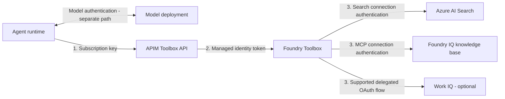
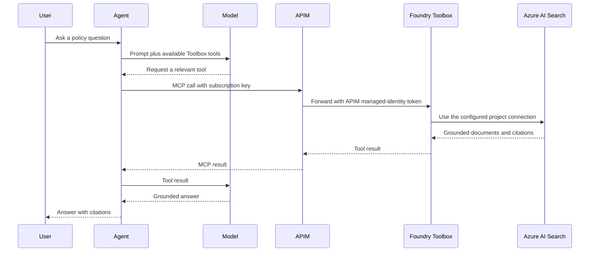
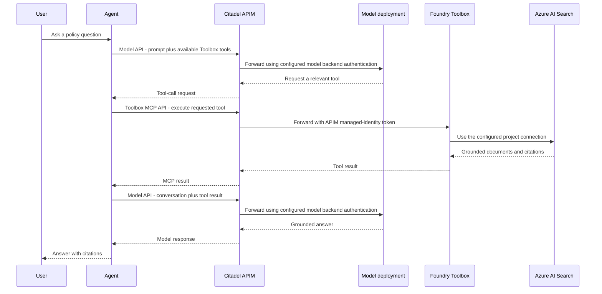

# Citadel Toolbox Add-on

A reusable Microsoft Foundry Toolbox configuration for Citadel. Publish approved tools and skills
in Foundry, expose them through Azure API Management (APIM), and connect an agent to one governed
MCP endpoint. Each entity supplies its own data, services, and connection references; credentials
remain in Foundry connections or an approved secret store.

## Start Here

**This is not a one-click document-ingestion or infrastructure deployment.** You need an existing
Foundry project and working knowledge sources. This repository does not supply policy documents,
create/populate a Search index, deploy a model, or create an APIM instance.

Follow this order for a first deployment:

1. [Understand the runtime and authentication](#how-tools-run-and-authenticate).
2. [Choose tools and check prerequisites](#prerequisites). If you have no index, start with the
    [new-index checklist](docs/tool-prerequisites.md#starting-without-an-index).
3. Clone the repository and [prepare your entity locally](#part-1-create-and-publish-the-toolbox).
4. If needed, [initialize Search and Foundry IQ connections](#optional-knowledge-initialization)
    against your existing populated index. Configure every enabled source, or disable it.
5. [Publish and validate the Toolbox](#validate-the-published-toolbox).
6. [Register it in an existing APIM instance](#part-2-register-the-toolbox-in-apim).
7. [Connect an agent](#connect-an-agent): use the Foundry portal demo or the Python example.

Already have a working Toolbox in APIM? Go directly to [Connect an Agent](#connect-an-agent).
For subsequent releases, use [Operate Versions](#operate-versions), not the first-version publisher.

### Documentation Map

| Need | Read |
| --- | --- |
| Per-tool infrastructure, identity, and data requirements | [Tool prerequisites](docs/tool-prerequisites.md) |
| Entity setup and owner handoff | [Entity onboarding](docs/entity-onboarding.md) |
| Search and Foundry IQ connection provisioning | [Optional knowledge initialization](#optional-knowledge-initialization) |
| Gateway registration, identities, and streaming | [APIM integration](docs/apim-mcp.md) |
| Runnable agent, environment settings, and troubleshooting | [Python example](examples/python-agent/README.md) |
| No-local-code agent demo in a Foundry spoke | [Foundry portal walkthrough](docs/foundry-portal-demo.md) |
| Microsoft overlay configuration | [Microsoft entity example](docs/microsoft-entity-example.md) |
| Design background | [Architecture](docs/architecture.md) |

## Start Here: What Is a Toolbox?

An AI agent can answer with a model, but it needs **tools** to retrieve private knowledge and
enterprise context. Connecting every agent separately to every service duplicates code,
credentials, and security decisions.

A [Microsoft Foundry Toolbox](https://learn.microsoft.com/azure/foundry/agents/concepts/toolbox-overview)
is a managed collection of those capabilities. Foundry exposes the collection through one
authenticated, MCP-compatible endpoint. An agent connects to that one URL, discovers the available
tools at runtime, and invokes the appropriate tool. Operators can version and update the Toolbox
without changing each consuming agent.

### How Citadel Uses the Toolbox

A Foundry Toolbox groups tools behind one MCP backend endpoint. Citadel places APIM in front of
it. Agents call the gateway; Foundry resolves and invokes the downstream tools. APIM can apply
configured authentication, rate limits, auditing, and access-contract policies. Registering an API
alone does not implement tool allowlists or document-level authorization.

The important terms are:

| Term | Meaning in this project |
| --- | --- |
| Agent | Application code that sends a prompt to a model and allows the model to call tools. |
| Tool | Something the agent can call, such as Azure AI Search or a knowledge-retrieval MCP operation. |
| Skill | Reusable instructions describing how to perform a task. Foundry skills are currently preview and are exposed as MCP resources. |
| MCP | Model Context Protocol, the protocol used by agents to discover and invoke Toolbox capabilities. |
| Project connection | A Foundry resource that stores a downstream endpoint and authentication configuration. The Toolbox references it by name; this repository does not store its credentials. |
| Toolbox version | An immutable snapshot of the Toolbox configuration. The first version is the default. Later versions are tested and explicitly promoted. |
| Backend consumer endpoint | The stable Foundry MCP URL printed after publication. It serves the Toolbox's current default version and becomes APIM's backend URL in Part 2. |
| Agent-facing endpoint | The APIM gateway URL printed after registration in Part 2. Consumers authenticate to APIM rather than receiving backend credentials. |

## How Tools Run and Authenticate

APIM is the gateway, Foundry Toolbox routes tool calls, and the downstream services perform
retrieval. The model selects a tool; **the agent runtime executes the call**, not the model itself.



### Example: A Policy Question

1. The agent sends the user's question and available tool definitions to the model.
2. The model requests discovery. The agent calls `tool_search` through APIM to find relevant tools.
3. APIM validates the consumer subscription and configured policies, then authenticates to Foundry.
4. Toolbox returns matching tool names and schemas, such as Foundry IQ's `knowledge_base_retrieve`.
5. The model selects a discovered tool. The agent invokes it using `call_tool` through the same
   APIM route, passing the exact discovered name and schema-compatible arguments.
6. Toolbox resolves the configured Foundry project connection and authenticates to that service.
7. The service returns evidence through Toolbox and APIM to the agent. The agent sends the result
   to the model, which produces an answer with source citations.

Discovery is relevance-based, not a guaranteed complete inventory. Finding a tool does not prove
its credentials, networking, or retrieval configuration work; test actual execution separately.

### Three Authentication Boundaries

| Hop | Authentication in the supplied APIM route | What it grants |
| --- | --- | --- |
| Agent to APIM | Consumer key in `Ocp-Apim-Subscription-Key` | Access to the gateway API under its subscription scope and applicable policies |
| APIM to Foundry Toolbox | APIM's selected managed identity obtains a token for `https://ai.azure.com` | Toolbox invocation, provided that identity has the required Foundry project access |
| Toolbox to a service | Credentials or supported identity configured in that service's Foundry project connection | Only the downstream permissions of that connection and authorization flow |

These are separate grants. An APIM key is not a Search key, APIM's identity is not the employee's
identity, and a successful APIM deployment does not establish downstream access. The registration
policy removes the consumer key before forwarding. Agents do not receive downstream credentials.

| Tool or resource | Backend authentication and behavior |
| --- | --- |
| Native Azure AI Search | Uses the Search project connection to query its configured index. Connection authentication and query/index compatibility must both work. |
| Foundry IQ | Uses its MCP project connection to call the knowledge-base endpoint; the knowledge base retrieves from its configured sources. |
| Toolbox Search | Built-in discovery inside Toolbox; no separate Search service credential or policy-document retrieval. |
| Work IQ | Requires its OAuth connection, consent, and supported delegated-user flow. The supplied shared APIM identity route alone is insufficient. |
| Skills | Instructions exposed through MCP resources, not independently authenticated retrieval services. The client must load them. |

The optional initializer uses a **broad Search admin API key** stored in the Search and Foundry IQ
connections. It does not configure least-privilege identity-based retrieval. With shared credentials,
access is not automatically trimmed to each employee's permissions. Enforce entity/document access
explicitly and validate denied-access cases before sharing the Toolbox. APIM products or subscription
keys alone do not filter tools or documents.

**Model authentication is separate.** The Python example calls the model directly using
`DefaultAzureCredential`; only Toolbox traffic passes through APIM. A Citadel model-through-APIM
deployment needs a separate model API, client configuration, and access contract. See the
[two architecture flows](#this-example-only-the-toolbox-is-behind-apim) below.

## What Is Included

| Type | Capability | Provider or Skill | Microsoft Default |
| --- | --- | --- | --- |
| Tool | Enterprise knowledge | Azure AI Search | Enabled |
| Tool | Policy knowledge | Microsoft Foundry IQ MCP | Enabled |
| Tool | Tool discovery | Toolbox Search | Enabled |
| Tool | Employee and M365 context | Work IQ preview | Enabled |
| Skill | Ground answers in Search or Foundry IQ evidence, cite sources, and handle insufficient evidence | [enterprise-grounding](skills/enterprise-grounding/SKILL.md) | Enabled in shared catalog; included in source |
| Skill | Retrieve authorized Work IQ context, respect delegated permissions, and handle consent failures | [workplace-context](skills/workplace-context/SKILL.md) | Enabled in Microsoft overlay; included in source |

These are Microsoft overlay defaults. Work IQ is optional and disabled by default in the shared
catalog; Microsoft enables it. Toolbox Search remains a distinct discovery tool.
Skills provide instructions, not data access, and must be published with the Toolbox before use.
Enabled in source does not mean published or authenticated: both IQ integrations
require existing project connections before a strict Microsoft build can succeed.

Work IQ requires delegated-user consent. A `CONSENT_REQUIRED` response can block tool discovery;
publication alone does not establish successful delegated access or end-to-end operation through APIM.

### Enterprise Knowledge

Enterprise Knowledge connects the Toolbox to an existing Azure AI Search index through a Foundry
project connection. It is intended for private policies, procedures, regulations, and organizational
guidance. The core catalog requests vector, semantic, and keyword hybrid retrieval and returns up to
five grounded results. Entity overlays select the index and can add an entity-specific filter. The
agent should cite the returned document title and source identifier and must not invent an answer
when the index does not contain sufficient evidence.

This repository does not create or populate the Search index. Foundry holds the Search connection,
and Citadel/APIM controls which agents may reach the governed Toolbox endpoint.

### Microsoft Foundry IQ

Microsoft Foundry IQ is enabled in
[entities/microsoft/overlay.yaml](entities/microsoft/overlay.yaml).

Foundry IQ exposes an existing Azure AI Search knowledge base as an MCP server with the
`knowledge_base_retrieve` tool. Configure a dedicated MCP project connection in the same Foundry
project as the Toolbox, using the knowledge base's complete endpoint. The optional
[knowledge initialization workflow](#optional-knowledge-initialization) can create this base and
connection for an existing index:

```text
https://<search-service>.search.windows.net/knowledgebases/<knowledge-base>/mcp?api-version=2026-08-01-preview
```

Set `MICROSOFT_FOUNDRY_IQ_MCP_URL` and `MICROSOFT_FOUNDRY_IQ_CONNECTION_ID` using
[entities/microsoft/.env.example](entities/microsoft/.env.example). The connection must target that
exact URL and provide its own authentication. Prefer a supported identity-based connection whose
identity has Search Index Data Reader on the search service. The APIM-to-Toolbox identity grant
does not grant Toolbox-to-Search access. For permission-protected knowledge, validate end-user
identity propagation and document-level filtering before enabling access for consumers.

The compiler emits only the project connection name for connection-backed MCP sources; inline
endpoint, approval, or tool-filter metadata does not configure the remote connection. Verify its
actual target and authentication before publication. Missing Foundry IQ variables intentionally
block a strict Microsoft build when Foundry IQ is enabled. Disabled optional capabilities require
no connection variables.

Editing source configuration does not update a live deployment. An existing Toolbox remains on its current immutable
version until a new version is created, tested through its version-specific endpoint, and promoted.
APIM's stable Toolbox backend URL does not need to change.

See [Query a knowledge base via MCP](https://learn.microsoft.com/azure/search/agentic-retrieval-how-to-retrieve#call-the-mcp-endpoint)
for supported API versions, authentication, and response behavior.

### Tool Discovery

Tool Discovery uses Foundry `toolbox_search`. It is a meta-tool rather than a business-system
integration: it searches the tools available inside the Toolbox and reveals the relevant tool to
the model when needed. This avoids placing every tool definition into every prompt. For example, a
policy question can discover Enterprise Knowledge or Microsoft Foundry IQ. Tool Discovery does not
bypass APIM policy, Foundry connection
authorization, tool allowlists, or approval requirements.

### Employee and M365 Context

Employee and M365 Context is reserved for Work IQ preview and is disabled by default. When enabled,
it uses delegated user identity so results remain within the signed-in user's permissions. The
current preview is not supported with network-isolated Foundry projects, so an entity must validate
its security and networking requirements before enabling it.

The Microsoft overlay enables this capability and requires `WORK_IQ_PROJECT_CONNECTION_ID`,
as shown in [entities/microsoft/.env.example](entities/microsoft/.env.example). The compiler
references that existing connection by name; it does not create the connection, obtain user
consent, or implement delegated authentication. Verify connection compatibility and user sign-in
before publishing. The current APIM subscription-key plus managed-identity route does not forward
the end user's identity and alone is insufficient for delegated Work IQ access.

### Tools and Skills

Tools perform retrieval and discovery. Skills are versioned instructions that tell an agent
how to select and safely use those tools. The shared catalog and Microsoft overlay provide:

- [Enterprise grounding](skills/enterprise-grounding/SKILL.md) directs the agent to authoritative
    Search or Foundry IQ evidence, effective policy documents, and traceable citations.
- [Workplace context](skills/workplace-context/SKILL.md), enabled by the Microsoft overlay,
    guides Work IQ retrieval within delegated permissions, handles consent failures, and separates
    workplace context from policy authority.

Published versions retain their attached skills until a new version is created, validated, and
promoted; this source catalog description is not a claim about the live skill inventory.

## How the Toolbox Is Built

| Input or operation | Owner and behavior |
| --- | --- |
| [Core catalog](catalog/core.yaml) | Platform-owned tool definitions and safety defaults |
| [Entity overlay](entities/example/overlay.yaml) | Entity-owned overrides, merged by stable `id`; no catalog fork |
| Entity's ignored `.env` | Non-secret connection IDs, index names, and endpoint references |
| [Compiler](src/citadel_toolbox/compiler.py) | Resolves variables, removes disabled entries, validates configuration, and writes disposable `generated/<entity>/toolbox.yaml` |
| [Publisher](scripts/Publish-Toolbox.ps1) | Strictly rebuilds, creates missing skills or reuses existing ones, creates a new Toolbox's first version, and prints its backend endpoint |
| [APIM registration](scripts/Register-ToolboxApim.ps1) | Registers the existing MCP backend in an existing gateway; does not provision source services or permissions |

Generated connection and skill names reference resources in the selected Foundry project.
Compilation does not check live credentials or retrieve documents. Publication refuses an existing
Toolbox name; later releases use the [version workflow](#operate-versions).

## Prerequisites

**Read the [per-tool prerequisite and readiness guide](docs/tool-prerequisites.md) before setup.**
This is a bring-your-own-data deployment, not a complete document-to-Toolbox installer. The example
`policy-index` is not included: users without an index must create Search, design and populate an
index from their own documents, and validate retrieval first.

- Windows PowerShell 7 or later
- Python 3.11 or newer
- [Azure CLI](https://learn.microsoft.com/cli/azure/install-azure-cli)
- [Azure Developer CLI](https://learn.microsoft.com/azure/developer/azure-developer-cli/install-azd)
- Access to an existing Microsoft Foundry project
- A project connection to Azure AI Search and an existing index

The deployment identity must belong to the tenant that owns the project and have permission to use
the project and its connections. The Foundry project, Search service, populated Search index, and
model deployment remain prerequisites. Use existing connections or explicitly run the optional
initializer below for Search and Foundry IQ. Work IQ connections and delegated consent remain
separate prerequisites; neither initialization nor publication provisions them.

| Enabled capability | Additional prerequisite |
| --- | --- |
| Native Search | Populated index with semantic configuration and a compatible integrated vectorizer for the current hybrid query mode; stored document vectors alone are insufficient |
| Foundry IQ | Knowledge source/base and authenticated MCP connection; the initializer's minimal semantic path does not require native Search's vectorizer |
| Toolbox Search | Healthy published sources; discovery is not a retrieval test |
| Work IQ (optional) | M365 entitlement, approved OAuth setup, delegated-user consent/flow, and compatible networking; APIM managed identity is not user delegation |
| Skills | Published references and explicit resource loading by the consuming agent |

The Microsoft overlay enables Work IQ. For policy-only use, follow the
[disable-Work-IQ configuration](docs/tool-prerequisites.md#work-iq-optional-preview); unresolved
connections or consent can block discovery of other sources.
The guide also covers [APIM and agent prerequisites](docs/tool-prerequisites.md#shared-runtime-and-apim-requirements)
and the checks required before calling a deployment ready.

## Part 1: Create and Publish the Toolbox

Run all commands from the repository root in PowerShell 7. Start with a new entity using the shared
Search-and-discovery defaults; Work IQ is disabled there. The Microsoft overlay enables additional
IQ sources and is not a ready-to-run configuration for a different customer's resources.

### Prepare Locally

```powershell
git clone https://github.com/sibamoussa/citadel-toolbox-addon.git
Set-Location citadel-toolbox-addon
./scripts/Setup-Toolbox.ps1 -Entity my-entity -SkipPublish
```

The script creates a local Python environment, installs dependencies, initializes or reuses the
entity, asks for its display name and Search connection ID/index, writes the ignored entity `.env`,
and runs strict validation. It does not create the Search index or verify live retrieval.

If the connection does not exist yet, use the optional initializer below before completing setup.
For overlays enabling Foundry IQ or Work IQ, configure their references in the entity's ignored
`.env` using its `.env.example` before strict validation can succeed. An initial run may stop at
that check; complete the references or disable unready sources, then rerun. `-SkipPublish` skips
cloud publication, not the strict build.

Reruns preserve the existing entity and `.env`. Use `-Reconfigure` only to intentionally replace
configuration. Never place downstream credentials in the entity's `.env` or overlay.

### Publish After Sources Are Ready

```powershell
./scripts/Setup-Toolbox.ps1 -Entity my-entity
```

The script rebuilds, installs the Foundry extension, signs in to the specified tenant, asks for the
project endpoint, creates missing skills, and publishes version 1. Save the printed **backend
consumer endpoint** for Part 2. Use a new Toolbox name; this workflow does not update an existing one.
Use `-UpdateSkills` only when intentionally publishing new skill versions.

In VS Code, **Terminal > Run Task > Citadel Toolbox: Guided local setup** prepares locally;
**Citadel Toolbox: Guided setup and publish** performs publication. Both use the same prerequisites.

Azure CLI and Azure Developer CLI maintain separate sign-in sessions. If publication reports
`AzureDeveloperCLICredential`, repeat `azd auth login --tenant-id '<owning-tenant-id>'`.

## Optional Knowledge Initialization

Skip this section if working Search and Foundry IQ connections already exist. Otherwise run it
after cloning and before publication. It does not make an unpopulated or incompatible index ready.

<details>
<summary>Provision a knowledge source, knowledge base, and two key-based connections</summary>

[scripts/Initialize-ToolboxKnowledge.ps1](scripts/Initialize-ToolboxKnowledge.ps1) is a separate,
opt-in provisioning step, not part of guided setup or publication. It creates only:

- A Search `searchIndex` knowledge source over an existing index and semantic configuration.
- A knowledge base using `minimal` reasoning and `extractiveData`, with no retrieval model.
- A Foundry `CognitiveSearch` / `ApiKey` project connection to the Search endpoint.
- A Foundry `RemoteTool` / `CustomKeys` project connection to the complete knowledge-base MCP URL.

This script supports **API-key authentication only**, for a service where API keys are enabled.
`-UseSearchApiKey` explicitly acknowledges that a **broad Search admin credential** will be read and
stored in the two Foundry connections. This is not a least-privilege query credential or an
end-user identity flow. Prefer an independently configured identity-based integration when supported;
the script never silently falls back between authentication modes or changes an existing mode.
The admin key is retrieved through ARM `listAdminKeys`, not generated or rotated, and is held only
in process memory before being sent to Foundry. No secrets are passed as CLI arguments, printed,
written to temporary files, or written to `.env`. Do not enable external request tracing,
PowerShell tracing, or body-logging proxies while running credential-bearing provisioning.

Run with PowerShell 7 and an already authenticated Azure CLI identity in the owning tenant. The
identity needs permission to list Search admin keys and read/create project connections, plus network
access to ARM and the Search data plane. The Search service must support the preview knowledge APIs,
with semantic search already configured on the existing populated index. No service, index,
ingestion pipeline, model, role assignment, or Work IQ resource is created.

Replace every placeholder, then run from the repository root:

```powershell
$knowledgeParameters = @{
    SubscriptionId = '<subscription-uuid>'
    ProjectResourceGroup = '<project-resource-group>'
    AccountName = '<foundry-account>'
    ProjectName = '<foundry-project>'
    SearchResourceGroup = '<search-resource-group>'
    SearchServiceName = '<search-service>'
    SearchIndexName = '<existing-index>'
    SearchConnectionName = '<search-connection>'
    KnowledgeSourceName = '<knowledge-source>'
    KnowledgeBaseName = '<knowledge-base>'
    FoundryIqConnectionName = '<foundry-iq-connection>'
    SemanticConfigurationName = '<existing-semantic-configuration>'
}
./scripts/Initialize-ToolboxKnowledge.ps1 @knowledgeParameters -WhatIf
$knowledge = ./scripts/Initialize-ToolboxKnowledge.ps1 @knowledgeParameters -UseSearchApiKey
$knowledge
```

`-WhatIf` validates input syntax but performs **no authentication, network calls, or file writes**;
it cannot validate remote prerequisites. A normal run reads the actual index, verifies the named
semantic configuration, and chooses only retrievable, present fields from `id`, `title`, `content`,
`source_file`, `source_path`, and `page_number` for `sourceDataFields`.
All four resources are inspected before any creates. Existing managed settings must match, including
connection target, category, authentication mode, and custom MCP metadata; drift is refused, not
reconciled. Only HTTP 404 on an optional resource lookup means missing. A 403, network failure, missing
index, or invalid semantic configuration stops the run. Conditional creates use `If-None-Match: *`;
a conflict or failed precondition stops without overwriting or retrying. Partial creation is possible;
inspect the resources and rerun after resolving the cause. The script does not delete resources.

Existing connection credentials are never fetched or rotated. Matching metadata does not prove a
stored key is current: validate runtime Search and Foundry IQ retrieval before publication.
Errors report only the operation and HTTP status, never service response bodies.

The result contains only nonsecret connection IDs, the MCP URL, and environment references. Manually
fill the existing entity's ignored `.env` using its `.env.example`: replace `<PREFIX>` with the
entity's uppercase prefix (for Microsoft, `MICROSOFT`), set the Search index name, and retain any
Work IQ references required by its overlay. No `.env` is automatically changed. Then run:

```powershell
$entity = 'my-entity'
./scripts/Build-Toolbox.ps1 -Entity $entity
./scripts/Publish-Toolbox.ps1 -Entity $entity `
    -ProjectEndpoint 'https://<account>.services.ai.azure.com/api/projects/<project>' `
    -ToolboxName '<new-toolbox-name>'
```

Publication creates missing skills; `toolbox_search` is a built-in Toolbox tool, not a separately
provisioned backend. Existing immutable Toolboxes are unchanged by initialization. For an existing
Toolbox name use [Operate Versions](#operate-versions), test the new version, and explicitly promote
it. Work IQ still requires its own compatible connection and delegated consent.

Run the initializer's Azure-independent tests with
`pwsh -NoProfile -File ./tests/Test-InitializeToolboxKnowledge.ps1`.

</details>

## Advanced Commands

The guided setup above is the normal path. Use these commands for an already configured entity
or automation; replace `$entity` and `$projectEndpoint` with your own values.

<details>
<summary>Build or publish directly instead of using guided setup</summary>

The guided script accepts parameters for repeatable or CI-driven execution, so every answer can be
supplied non-interactively. Run `Get-Help ./scripts/Setup-Toolbox.ps1 -Detailed` for its parameter
list.

Build an existing entity without publishing:

```powershell
./scripts/Build-Toolbox.ps1 -Entity $entity
```

Strict compilation rejects missing variables, empty values, unchanged `<placeholder>` values,
missing connection fields, missing skill files, and unsafe write-tool approval settings.

Publish a configured entity directly:

```powershell
./scripts/Publish-Toolbox.ps1 `
    -Entity $entity `
    -ProjectEndpoint $projectEndpoint `
    -ToolboxName "$entity-toolbox"
```

The script strictly rebuilds the definition, selects the project, creates missing core skills,
reuses existing skills, checks for a Toolbox name collision, and creates version 1. Version 1
becomes the default automatically. Use `-UpdateSkills` only when intentionally publishing new skill
versions.

</details>

### Validate the Published Toolbox

Use the same entity, Toolbox name, and project endpoint chosen during publication:

```powershell
$entity = 'my-entity'
$projectEndpoint = 'https://<account>.services.ai.azure.com/api/projects/<project>'
$toolboxName = "$entity-toolbox"
$env:AZURE_DEV_USER_AGENT = 'microsoft_foundry_skill'
try {
    azd ai toolbox show $toolboxName `
        --project-endpoint $projectEndpoint --output json --no-prompt
    azd ai toolbox versions list $toolboxName `
        --project-endpoint $projectEndpoint --output table --no-prompt
}
finally {
    Remove-Item Env:AZURE_DEV_USER_AGENT -ErrorAction SilentlyContinue
}
```

Test the version-specific MCP endpoint reported by the CLI before connecting agents. Confirm Search
returns authorized results with expected citations, Toolbox Search discovers the intended tools,
and `resources/list` discovers the expected skills. Validate Microsoft Foundry IQ retrieval and
delegated Work IQ access separately when enabled.

Check both HTTP status and JSON-RPC `error`/tool `isError`. HTTP 200 and a successful deployment
are not proof of retrieval. Stop and fix or disable failing sources before registering consumers.

## Part 2: Register the Toolbox in APIM

Part 1 creates the managed Toolbox and prints its backend consumer endpoint. Part 2 registers that
**existing MCP server** in an existing APIM instance; it does not recreate the Toolbox or import
the catalog YAML into APIM. The resulting API appears under **APIs > MCP servers**.

Before registration, enable APIM's system-assigned managed identity or attach an existing
user-assigned managed identity (UAMI), grant the selected identity permission to invoke
the Foundry Toolbox, and ensure APIM can reach the endpoint. Use a supported APIM tier (not
Consumption). Disable global and API-level response payload logging and avoid inherited policies
that buffer MCP responses. See [the APIM integration guide](docs/apim-mcp.md) for the full
prerequisites, identity model, and production security boundaries.

From the repository root, use the full consumer endpoint printed by Part 1:

```powershell
./scripts/Register-ToolboxApim.ps1 `
    -SubscriptionId '<subscription-id>' `
    -ResourceGroup '<existing-apim-resource-group>' `
    -ApimName '<existing-apim-name>' `
    -ApiId citadel-toolbox -ApiPath citadel-toolbox `
    -BackendClientId '<attached-uami-client-id-uuid>' `
    -ProductId '<existing-product-id>' `
    -BackendUrl 'https://<foundry-account>.services.ai.azure.com/api/projects/<project>/toolboxes/<toolbox>/mcp?api-version=v1'
```

`-BackendClientId` and `-ProductId` are independent, optional arguments. Omit the client ID for
the existing system-assigned identity behavior. A UAMI client ID must be a hyphenated UUID, not
the principal/resource ID, and requires a backend audience (default `https://ai.azure.com`).
Omit the product ID to leave product associations unchanged; otherwise use an existing product's
resource segment ID, not its display name or full resource ID.

Add `-WhatIf` to preview the target without writing files or calling Azure. The actual run generates
an ARM template, checks APIM's tier and the system identity or attached UAMI client ID,
checks the existing product when specified, validates the deployment, and creates or updates
a TLS-validated backend, a subscription-protected native MCP API, and a streaming-safe policy.
An optional fourth resource associates the API with the existing product after API creation.
It uses APIM's managed identity to authenticate to Foundry with audience `https://ai.azure.com`.
This is a shared service identity, not delegated user authentication.

The script prints the agent-facing URL, normally:

```text
https://<apim-name>.azure-api.net/citadel-toolbox
```

The native MCP endpoint is exactly `-ApiPath`; no `/mcp` suffix is appended.
With `-ApiPath citadel-toolbox`, consumers use `/citadel-toolbox`. With a custom path such as
`-ApiPath 'mcp/citadel-toolbox'`, they use `/mcp/citadel-toolbox`. No compatibility alias is created.
The backend Foundry toolbox URL still requires its `/mcp` path.

Use a valid API-scoped or associated product-scoped APIM subscription for the consumer,
then configure an HTTP MCP client with
this URL and the `Ocp-Apim-Subscription-Key` header. The guide includes a VS Code configuration
that prompts for the key rather than storing it in source control. The script does not create
products or subscriptions, attach identities, grant Foundry roles, or implement agent-side approval.
Reusing an API ID replaces
its backend configuration and API policy; use `-ApiId` and `-ApiPath` for separate entity routes.

Before routing production traffic, verify MCP initialization, tool discovery, and a read-only
tool call through APIM. Confirm requests without a valid subscription fail, compare tool results
with the direct checks in Part 1, and verify skill discovery with a resources-capable client.
ARM deployment success alone does not prove backend authorization or MCP behavior.

To generate the registration without deploying or signing in to Azure:

```powershell
citadel-toolbox export-apim `
    --apim-name '<existing-apim-name>' `
    --backend-url '<full-consumer-endpoint-from-part-1>' `
    --api-id citadel-toolbox --path citadel-toolbox `
    --backend-audience https://ai.azure.com `
    --backend-client-id '<attached-uami-client-id-uuid>' `
    --product-id '<existing-product-id>' `
    --output generated/apim/registration.json
```

The client ID and product ID flags are optional. Without them the export still contains three
resources. Export validates inputs locally; only the registration script checks identity attachment
and product existence in Azure before deployment. Neither command grants roles.

## Connect an Agent

Choose either client below. Both consume the same APIM-hosted Toolbox; neither creates another
Toolbox or provisions its knowledge sources.

| Demo | Client and model path | Walkthrough |
| --- | --- | --- |
| Foundry portal | Agent Playground in the consuming project; uses that agent's configured model, including its AI Gateway route when present | [Portal connection and demo script](docs/foundry-portal-demo.md) |
| Python | Local Agent Framework server; model connects directly to Foundry using Entra authentication | [Python example](examples/python-agent/README.md) and commands below |

### Foundry Portal Demo

In the spoke project, open **Agents > your agent > Playground > Tools > Add** and select the remote
**Model Context Protocol (MCP)** option. Do not select **Create toolbox** to connect to an existing one.
Enter a unique name, the exact APIM MCP endpoint, and **Key-based** authentication. Add the credential
pair `Ocp-Apim-Subscription-Key` and an authorized APIM subscription key, then connect and save.
APIM registration alone does not automatically attach the Toolbox to a spoke agent.

Use the [full portal walkthrough](docs/foundry-portal-demo.md) for field-by-field setup, ready-to-use
agent instructions, discovery and policy-retrieval prompts, approvals, and trace checks. It also
explains the model's separate authentication and why connected tools do not prove skills were loaded.

### Python Agent Demo

The [Python agent example](examples/python-agent/README.md) supports the APIM URL from Part 2
using `MCPStreamableHTTPTool` and an `Ocp-Apim-Subscription-Key` header. New setup files default to
this route. The agent's model connection remains a separate Entra-authenticated Foundry connection.
This example consumes an existing Toolbox; it does not provision or publish one.

### Configure the APIM Route

From the repository root:

```powershell
./examples/python-agent/Setup.ps1
```

Configure the example's ignored `.env` using your own endpoints and securely obtained key:

```dotenv
FOUNDRY_PROJECT_ENDPOINT=https://<account>.services.ai.azure.com/api/projects/<project>
AZURE_AI_MODEL_DEPLOYMENT_NAME=<model-deployment-name>
TOOLBOX_CONNECTION_MODE=apim
TOOLBOX_ENDPOINT=https://<apim-name>.azure-api.net/citadel-toolbox
APIM_SUBSCRIPTION_KEY=<api-scoped-subscription-key>
```

Create an active API-scoped or associated product-scoped subscription in APIM and obtain its key securely. Use the actual gateway
URL printed by registration, exactly matching the configured API path, with no query parameters. The registration
script does not create consumer subscriptions. Keep the key out of source control, prompts, browser
code, and logs; inject it from your hosting secret store in production.

The developer/workload identity needs model access. APIM's identity needs Toolbox access; each
downstream connection needs source access. See [Three Authentication Boundaries](#three-authentication-boundaries).
This client targets the subscription-key policy in Part 2. OAuth-protected gateways require a
corresponding client authentication implementation; this is not delegated Work IQ authentication.

### Run and Verify

Run the agent server from the repository root:

```powershell
./examples/python-agent/.venv/Scripts/python.exe ./examples/python-agent/main.py
```

Alternatively, press **F5** and select **Debug Citadel Toolbox Agent Example** to test in Agent
Inspector. Ask a question whose answer exists in your own documents. Inspect the tool call and
compare its answer/citations with the evidence; then verify an invalid APIM subscription key fails.
Startup alone is not an end-to-end test. See the [example's run instructions](examples/python-agent/README.md#run)
and [troubleshooting](examples/python-agent/README.md#verify-and-troubleshoot) for client details
and offline checks.

Setup preserves existing `.env` files. When upgrading an old example, add
`TOOLBOX_CONNECTION_MODE=apim` and the APIM settings explicitly. Skills require explicit resource
loading; this example demonstrates callable tools and does not automatically apply attached skills.

### How the Python Example Uses the Toolbox

<details>
<summary>Implementation and architecture: sample route versus Citadel model-and-tool routes</summary>

[main.py](examples/python-agent/main.py) and
[toolbox_connection.py](examples/python-agent/toolbox_connection.py) perform four jobs:

1. Load the example's own `.env` and validate the connection mode, endpoint, and APIM key.
2. `FoundryChatClient` connects the agent to the selected model deployment.
3. In `apim` mode, `MCPStreamableHTTPTool` sends the subscription key on MCP requests and disables
   prompt discovery because APIM does not support MCP prompts.
4. Open the MCP session with `async with toolbox`, discover tools, pass them to `Agent`, and keep
   the connection open while `ResponsesHostServer` runs. Shutdown or failure closes the session.

```python
toolbox = MCPStreamableHTTPTool(
    name="citadel-toolbox",
    url=os.environ["TOOLBOX_ENDPOINT"],
    static_headers={"Ocp-Apim-Subscription-Key": os.environ["APIM_SUBSCRIPTION_KEY"]},
    load_prompts=False,
)
async with toolbox:
    agent = Agent(client=client, tools=toolbox, default_options={"store": False})
    await ResponsesHostServer(agent).run_async()
```

#### This Example: Only the Toolbox Is Behind APIM

The runnable example connects directly to the model through `FoundryChatClient`. Only MCP
requests to the Toolbox pass through APIM. For a prompt that requires private policy information:



#### Citadel Entities: Model and Toolbox Behind APIM

For entities using Citadel to govern both models and tools, the agent sends model requests to
Citadel's model API in APIM and MCP requests to its Toolbox API in APIM. These are separate API
routes, even when hosted by the same gateway. The model returns a tool-call request; the agent
executes it through the Toolbox route and sends the result back through the model route.



This second flow describes the Citadel entity route, not additional functionality configured by
this sample. Running it requires a Citadel model API, its client-compatible endpoint and
authentication, and the appropriate model access contract in addition to Toolbox access. The
model and Toolbox routes can have different consumer credentials and backend identities; a
Toolbox subscription key does not automatically grant model access. This example configures
only the Toolbox behind APIM and does not configure or test the model-through-APIM route.

The example targets the default read-only Toolbox. Tool approval metadata is returned to the client,
but the Toolbox endpoint does not enforce approval by itself. Before enabling state-changing tools,
the consuming runtime must pause the exact pending call, show its arguments, and require explicit
user approval. A system prompt is not an enforcement mechanism.

Tools are discovered through MCP tools. Attached Foundry skills are exposed separately as MCP
resources and require a client integration that supports MCP Resources and skill loading. The sample
demonstrates the callable-tool path; do not assume that merely constructing `FoundryToolbox` injects
every attached skill into the model's instructions.

Neither connection mode automatically loads attached skill resources. Use a read-only Toolbox;
the API name and subscription key do not enforce tool-level approval or remove action tools.

</details>

### Optional Direct Foundry Integration

For Part 1 validation without APIM, retain the model settings and use:

```dotenv
TOOLBOX_CONNECTION_MODE=foundry
TOOLBOX_ENDPOINT=https://<account>.services.ai.azure.com/api/projects/<project>/toolboxes/<toolbox-name>/mcp?api-version=v1
```

This mode uses `FoundryToolbox(credential, url=endpoint)` and ignores `APIM_SUBSCRIPTION_KEY`.
The agent's identity needs direct Toolbox access as well as model access. For backward compatibility,
omitting `TOOLBOX_CONNECTION_MODE` also selects direct Foundry mode. Set it explicitly to `apim`
to use the gateway; changing only the URL is not sufficient. .NET direct clients can use
`AddFoundryToolboxes`; other agent runtimes must configure their own MCP transport authentication.

## Troubleshooting

| Symptom | Check or action |
| --- | --- |
| Strict build reports missing references | Fill every enabled source's variables from the entity `.env.example`, or disable the unready source and its related skill. |
| Native Search reports a missing integrated vectorizer | Stored vectors are insufficient for the current hybrid mode. Configure the compatible query-time vectorizer; see [native Search prerequisites](docs/tool-prerequisites.md#native-azure-ai-search). |
| Work IQ consent or missing-connection error blocks discovery | Complete its supported OAuth flow or [exclude Work IQ](docs/tool-prerequisites.md#work-iq-optional-preview) in a new test version; never bypass authentication. |
| APIM returns 401/403 | Check the consumer subscription scope/state and applicable policies first; separately verify APIM identity permissions and downstream access. |
| APIM returns 404 | Use the exact configured API path, with no automatic `/mcp` suffix. The Foundry backend still needs its own `/mcp` path. |
| Tools are found but retrieval fails | Inspect JSON-RPC errors, source credentials, network reachability, and index configuration. Discovery does not test execution. |
| Foundry IQ works but native Search fails | They can use the same index with different retrieval requirements. Test and configure each path independently. |
| No useful policy answer | Verify ingestion, indexed content, permissions, and source metadata. This repository does not include a populated `policy-index`. |
| Skills do not affect responses | Confirm published skill resources and explicit client loading; this Python example does not automatically load them. |

## Operate Versions

Foundry Toolbox versions are immutable. The publish script creates the first version only. For an
existing Toolbox, use the installed `azd ai toolbox connection add/remove` and
`azd ai toolbox skill add/remove` commands to branch a new version, then test its version-specific
endpoint. Run each command with `--help` because available provider options follow the installed
`microsoft.foundry` extension version.

Promote a validated version:

```powershell
$env:AZURE_DEV_USER_AGENT = 'microsoft_foundry_skill'
try {
    azd ai toolbox publish $toolboxName '<new-version>' `
        --project-endpoint $projectEndpoint --no-prompt
}
finally {
    Remove-Item Env:AZURE_DEV_USER_AGENT -ErrorAction SilentlyContinue
}
```

Rollback uses the same command with the last known-good version. List available versions first:

```powershell
azd ai toolbox versions list $toolboxName `
    --project-endpoint $projectEndpoint --output table --no-prompt
azd ai toolbox publish $toolboxName '<known-good-version>' `
    --project-endpoint $projectEndpoint --no-prompt
```

## Production Guardrails

- Store credentials only in Foundry project connections or an approved secret store.
- Use separate read and action MCP deployments, connections, and managed identities.
- Enforce approval in the consuming runtime; metadata alone does not block a call.
- Test immutable version endpoints before changing the default version.
- Keep Work IQ disabled unless delegated-user consent and network constraints are satisfied.
- Treat generated Toolbox definitions as disposable build artifacts.

See [entity onboarding](docs/entity-onboarding.md), the generic
[Microsoft example](docs/microsoft-entity-example.md), and [architecture](docs/architecture.md) for
additional context.

## Microsoft Reference Documentation

- [What is Toolbox in Microsoft Foundry?](https://learn.microsoft.com/azure/foundry/agents/concepts/toolbox-overview)
- [Create and manage a Toolbox](https://learn.microsoft.com/azure/foundry/agents/how-to/tools/toolbox)
- [Toolbox and hosted-agent integration](https://learn.microsoft.com/azure/foundry/agents/how-to/tools/use-toolbox-hosted-agent)
- [Toolbox end-to-end quickstart](https://learn.microsoft.com/azure/foundry/agents/quickstarts/quickstart-toolbox-agent)
- [Use skills with Foundry agents](https://learn.microsoft.com/azure/foundry/agents/how-to/tools/skills)
- [Enable tool search in a Toolbox](https://learn.microsoft.com/azure/foundry/agents/how-to/tools/tool-search)
- [Microsoft Agent Framework overview](https://learn.microsoft.com/agent-framework/overview/agent-framework-overview)
- [Model Context Protocol overview](https://modelcontextprotocol.io/docs/getting-started/intro)
