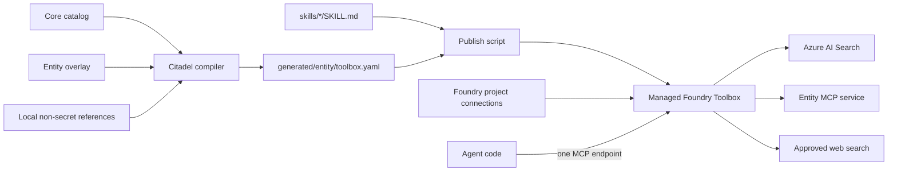
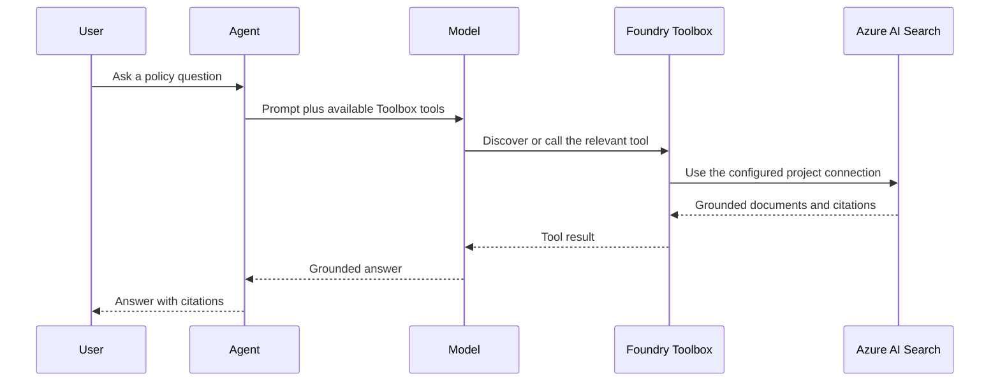

# Citadel Toolbox Add-on

A reusable Microsoft Foundry Toolbox add-on for Citadel deployments. A governed core defines the
approved tools and skills; each customer supplies only an entity overlay and Foundry connection
references. Customers do not fork the catalog or store credentials in this repository.

## Start Here: What Is a Toolbox?

An AI agent can answer with a model, but it needs **tools** to retrieve private knowledge, search the
web, or call business systems. Connecting every agent separately to every service duplicates code,
credentials, and security decisions.

A [Microsoft Foundry Toolbox](https://learn.microsoft.com/azure/foundry/agents/concepts/toolbox-overview)
is a managed collection of those capabilities. Foundry exposes the collection through one
authenticated, MCP-compatible endpoint. An agent connects to that one URL, discovers the available
tools at runtime, and invokes the appropriate tool. Operators can version and update the Toolbox
without changing each consuming agent.

The important terms are:

| Term | Meaning in this project |
| --- | --- |
| Agent | Application code that sends a prompt to a model and allows the model to call tools. |
| Tool | Something the agent can call, such as Azure AI Search, web search, or an MCP operation. |
| Skill | Reusable instructions describing how to perform a task. Foundry skills are currently preview and are exposed as MCP resources. |
| MCP | Model Context Protocol, the protocol used by agents to discover and invoke Toolbox capabilities. |
| Project connection | A Foundry resource that stores a downstream endpoint and authentication configuration. The Toolbox references it by name; this repository does not store its credentials. |
| Toolbox version | An immutable snapshot of the Toolbox configuration. The first version is the default. Later versions are tested and explicitly promoted. |
| Consumer endpoint | The stable MCP URL used by agents. It always serves the Toolbox's current default version. |

### What This Repository Adds

Foundry provides the managed Toolbox service. This repository adds a repeatable governance and
deployment layer for Citadel:

1. The platform team defines the reusable capabilities and safety defaults once in
    [`catalog/core.yaml`](catalog/core.yaml).
2. Each entity changes only its own [`entities/<entity>/overlay.yaml`](entities/example/overlay.yaml),
    such as connection references, an index name, and approved web domains.
3. The Python compiler in [`src/citadel_toolbox/compiler.py`](src/citadel_toolbox/compiler.py) merges
    the two files, resolves local environment variables, removes disabled entries, validates safety
    rules, and renders the YAML format accepted by Foundry.
4. [`scripts/Publish-Toolbox.ps1`](scripts/Publish-Toolbox.ps1) uploads the local `SKILL.md` files and
    calls `azd ai toolbox create --from-file` to create the managed Toolbox in the selected Foundry
    project.
5. Agents connect to the resulting endpoint. They do not import this compiler or receive downstream
    service credentials.



This repository does **not** create the Foundry project, model deployment, Search index, entity MCP
backend, or project connections. Those resources must already exist. It creates the governed
Toolbox definition that joins them and publishes that definition to Foundry.

## What Is Included

| Capability | Provider | Default |
| --- | --- | --- |
| Enterprise knowledge | Azure AI Search | Enabled |
| Government systems | Read-only MCP | Enabled |
| Approved public information | Restricted Web Search | Enabled |
| Tool discovery | Toolbox Search | Enabled |
| Employee and M365 context | Work IQ preview | Disabled |
| Workflow actions | Approval-gated MCP | Disabled |

Three reusable Foundry skills are provisioned by the publish script: enterprise grounding,
government service routing, and safe transactions.

## How the Toolbox Is Built

For the example entity, the build has three inputs:

- [`catalog/core.yaml`](catalog/core.yaml) supplies the complete approved catalog and defaults.
- [`entities/example/overlay.yaml`](entities/example/overlay.yaml) overrides only entity-owned
    values. Items merge by stable `id`, so the entity does not copy the core catalog.
- `entities/example/.env` supplies local connection resource IDs and endpoint values. It is ignored
    by Git and is used only while compiling.

`Build-Toolbox.ps1` loads those values and runs the compiler. Strict compilation fails when a value
is missing, a placeholder remains, a required connection field is absent, a referenced skill file
does not exist, or a write-capable tool lacks `require_approval: always`.

The disposable output is `generated/example/toolbox.yaml`. For the example configuration it has the
following Foundry-facing shape:

```yaml
description: Shared Citadel capabilities customized for Example Entity.
connections:
    - name: search
        index: policy-index
    - name: read-mcp
tools:
    - type: web_search
        filters:
            allowed_domains: [example.gov, legislation.example.gov]
        require_approval: never
        name: approved-web-search
    - type: toolbox_search
skills:
    - name: enterprise-grounding
    - name: government-service-routing
    - name: safe-transaction
```

The `connections` names refer to existing Foundry project connections. Their keys, tokens, and
identity configuration remain in Foundry. The `toolbox_search` entry lets the model discover relevant
tools on demand instead of placing every tool definition in every prompt. Skill entries refer to
versioned skills that the publish script creates in the same Foundry project.

During publication, the script performs these operations in order:

1. Rebuild and strictly validate the generated YAML.
2. Select the target Foundry project.
3. Create missing skills from the repository's `skills/*/SKILL.md` files, or reuse existing skills.
4. Refuse to overwrite an existing Toolbox name through the first-version workflow.
5. Create Toolbox version 1 from the generated YAML. Foundry makes this first version the default.
6. Print the stable consumer endpoint for agent applications.

## Prerequisites

- Windows PowerShell 7 or later
- Python 3.11 or newer
- [Azure CLI](https://learn.microsoft.com/cli/azure/install-azure-cli)
- [Azure Developer CLI](https://learn.microsoft.com/azure/developer/azure-developer-cli/install-azd)
- Access to an existing Microsoft Foundry project
- A project connection to Azure AI Search and an existing index
- A project connection to a deployed read-only MCP endpoint

The deployment identity must belong to the tenant that owns the project and have permission to use
the project and its connections. This add-on does not create the Foundry project, Search index, MCP
service, or project connections.

## Guided Deployment

The guided setup creates the Python environment, installs dependencies, initializes or reuses an
entity, collects non-secret connection references, writes the ignored `.env`, runs a strict build,
installs the Foundry extension, signs in, provisions missing skills, and publishes version 1.

### Option A: VS Code

1. Clone and open the repository in VS Code.
2. Open **Terminal > Run Task**.
3. Select **Citadel Toolbox: Guided setup and publish**.
4. Answer the prompts.

Use **Citadel Toolbox: Guided local setup** when you want to configure and validate without
publishing to Foundry.

### Option B: One Command

```powershell
git clone https://github.com/sibamoussa/citadel-toolbox-addon.git
Set-Location citadel-toolbox-addon
./scripts/Setup-Toolbox.ps1
```

The script prompts for:

- Entity name and display name
- Search connection resource ID and index name
- Read-only MCP connection resource ID and endpoint
- Approved web domains
- Foundry tenant ID and project endpoint

Rerunning the script reuses the entity and its local `.env`. Add `-Reconfigure` to replace those
values, `-SkipPublish` for local setup only, or `-UpdateSkills` when intentionally publishing new
skill versions.

If a later command reports `AzureDeveloperCLICredential`, repeat `azd auth login` with the owning
tenant ID. Azure CLI and Azure Developer CLI maintain separate sign-in sessions.

## Advanced Commands

The guided script accepts parameters for repeatable or CI-driven execution, so every answer can be
supplied non-interactively. Run `Get-Help ./scripts/Setup-Toolbox.ps1 -Detailed` for its parameter
list.

Build an existing entity without publishing:

```powershell
./scripts/Build-Toolbox.ps1 -Entity $entity
```

Strict compilation rejects missing variables, empty values, unchanged `<placeholder>` values,
missing connection fields, missing skill files, and unsafe write-tool approval settings.

Publish a configured entity directly:

```powershell
./scripts/Publish-Toolbox.ps1 `
    -Entity $entity `
    -ProjectEndpoint $projectEndpoint `
    -ToolboxName "$entity-toolbox"
```

The script strictly rebuilds the definition, selects the project, creates missing core skills,
reuses existing skills, checks for a Toolbox name collision, and creates version 1. Version 1
becomes the default automatically. Use `-UpdateSkills` only when intentionally publishing new skill
versions.

## Validate the Deployment

```powershell
$toolboxName = "$entity-toolbox"
$env:AZURE_DEV_USER_AGENT = 'microsoft_foundry_skill'
try {
    azd ai toolbox show $toolboxName `
        --project-endpoint $projectEndpoint --output json --no-prompt
    azd ai toolbox versions list $toolboxName `
        --project-endpoint $projectEndpoint --output table --no-prompt
}
finally {
    Remove-Item Env:AZURE_DEV_USER_AGENT -ErrorAction SilentlyContinue
}
```

Test the version-specific MCP endpoint reported by the CLI before connecting agents. Confirm Search
returns expected citations, web search stays within approved domains, `resources/list` discovers the
skills, the read MCP enforces identity and authorization, and no state-changing operation is
available.

## Connect an Agent

Use the stable endpoint only after validation:

```text
{project-endpoint}/toolboxes/{toolbox-name}/mcp?api-version=v1
```

Python hosted agents use Agent Framework `FoundryToolbox`; .NET hosted agents use
`AddFoundryToolboxes`; prompt agents attach the endpoint as a remote MCP tool. The client must
support MCP Resources to discover attached skills.

### How the Python Example Uses the Toolbox

The runnable [Python agent example](examples/python-agent/README.md) is a separate consumer of the
published Toolbox. It does not build or publish the Toolbox. Its `.env` contains only:

```dotenv
FOUNDRY_PROJECT_ENDPOINT=https://<account>.services.ai.azure.com/api/projects/<project>
AZURE_AI_MODEL_DEPLOYMENT_NAME=<model-deployment-name>
TOOLBOX_ENDPOINT=https://<account>.services.ai.azure.com/api/projects/<project>/toolboxes/<toolbox-name>/mcp?api-version=v1
```

[`examples/python-agent/main.py`](examples/python-agent/main.py) then performs four jobs:

1. `DefaultAzureCredential` obtains the caller's Microsoft Entra identity. No tool credential is
    embedded in the code.
2. `FoundryChatClient` connects the agent to the selected model deployment.
3. `FoundryToolbox` reads `TOOLBOX_ENDPOINT`, authenticates MCP requests, discovers callable tools,
    and forwards tool calls to Foundry.
4. `Agent(..., tools=toolbox)` gives the model those capabilities, while `ResponsesHostServer`
    exposes the agent through the Foundry Responses hosting protocol.

```python
credential = DefaultAzureCredential()
toolbox = FoundryToolbox(credential)
client = FoundryChatClient(
    project_endpoint=os.environ["FOUNDRY_PROJECT_ENDPOINT"],
    model=os.environ["AZURE_AI_MODEL_DEPLOYMENT_NAME"],
    credential=credential,
)
agent = Agent(client=client, tools=toolbox, default_options={"store": False})
```

For a prompt that requires private policy information, the runtime flow is:



The example targets the default read-only Toolbox. Tool approval metadata is returned to the client,
but the Toolbox endpoint does not enforce approval by itself. Before enabling state-changing tools,
the consuming runtime must pause the exact pending call, show its arguments, and require explicit
user approval. A system prompt is not an enforcement mechanism.

Tools are discovered through MCP tools. Attached Foundry skills are exposed separately as MCP
resources and require a client integration that supports MCP Resources and skill loading. The sample
demonstrates the callable-tool path; do not assume that merely constructing `FoundryToolbox` injects
every attached skill into the model's instructions.

Set `TOOLBOX_ENDPOINT` to the stable endpoint above. Run
`./examples/python-agent/Setup.ps1`, replace the placeholders in the generated `.env`, and press
**F5** in VS Code to test the agent in Foundry Toolkit Agent Inspector.

## Operate Versions

Foundry Toolbox versions are immutable. The publish script creates the first version only. For an
existing Toolbox, use the installed `azd ai toolbox connection add/remove` and
`azd ai toolbox skill add/remove` commands to branch a new version, then test its version-specific
endpoint. Run each command with `--help` because available provider options follow the installed
`microsoft.foundry` extension version.

Promote a validated version:

```powershell
$env:AZURE_DEV_USER_AGENT = 'microsoft_foundry_skill'
try {
    azd ai toolbox publish $toolboxName '<new-version>' `
        --project-endpoint $projectEndpoint --no-prompt
}
finally {
    Remove-Item Env:AZURE_DEV_USER_AGENT -ErrorAction SilentlyContinue
}
```

Rollback uses the same command with the last known-good version. List available versions first:

```powershell
azd ai toolbox versions list $toolboxName `
    --project-endpoint $projectEndpoint --output table --no-prompt
azd ai toolbox publish $toolboxName '<known-good-version>' `
    --project-endpoint $projectEndpoint --no-prompt
```

## Local MCP Reference Server

The included in-memory MCP service is a development adapter, not a production backend. Read and
action profiles are deliberately separate:

```powershell
python -m citadel_toolbox_mcp.server --profile read --transport streamable-http
python -m citadel_toolbox_mcp.server --profile actions --transport streamable-http
```

The VS Code development configuration in `.vscode/mcp.json` starts the read profile over stdio.
Replace `GovernmentService` with an authenticated entity backend before production deployment.

## Production Guardrails

- Store credentials only in Foundry project connections or an approved secret store.
- Use separate read and action MCP deployments, connections, and managed identities.
- Enforce approval in the consuming runtime; metadata alone does not block a call.
- Test immutable version endpoints before changing the default version.
- Keep Work IQ disabled unless delegated-user consent and network constraints are satisfied.
- Treat generated Toolbox definitions as disposable build artifacts.

See [entity onboarding](docs/entity-onboarding.md), the generic
[Microsoft example](docs/microsoft-entity-example.md), and [architecture](docs/architecture.md) for
additional context.

## Microsoft Reference Documentation

- [What is Toolbox in Microsoft Foundry?](https://learn.microsoft.com/azure/foundry/agents/concepts/toolbox-overview)
- [Create and manage a Toolbox](https://learn.microsoft.com/azure/foundry/agents/how-to/tools/toolbox)
- [Toolbox and hosted-agent integration](https://learn.microsoft.com/azure/foundry/agents/how-to/tools/use-toolbox-hosted-agent)
- [Toolbox end-to-end quickstart](https://learn.microsoft.com/azure/foundry/agents/quickstarts/quickstart-toolbox-agent)
- [Use skills with Foundry agents](https://learn.microsoft.com/azure/foundry/agents/how-to/tools/skills)
- [Enable tool search in a Toolbox](https://learn.microsoft.com/azure/foundry/agents/how-to/tools/tool-search)
- [Microsoft Agent Framework overview](https://learn.microsoft.com/agent-framework/overview/agent-framework-overview)
- [Model Context Protocol overview](https://modelcontextprotocol.io/docs/getting-started/intro)
