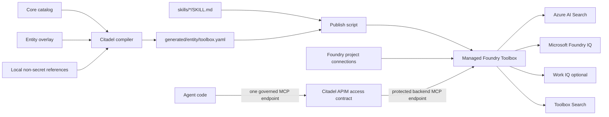
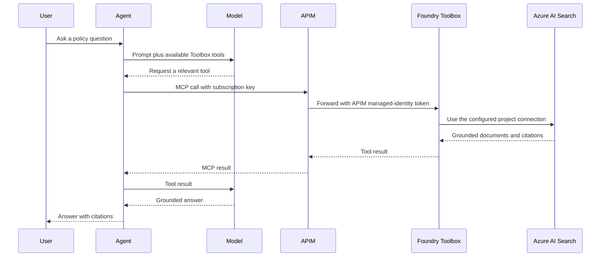
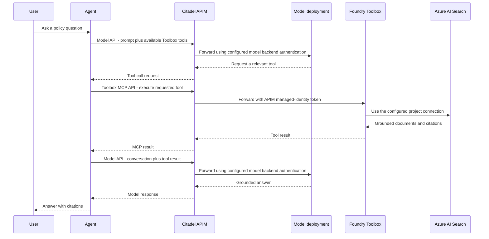

# Citadel Toolbox Add-on

A reusable Microsoft Foundry Toolbox add-on for Citadel deployments. A governed core defines the
approved tools and skills; each customer supplies only an entity overlay and Foundry connection
references. Customers do not fork the catalog or store credentials in this repository.

## Start Here: What Is a Toolbox?

An AI agent can answer with a model, but it needs **tools** to retrieve private knowledge and
enterprise context. Connecting every agent separately to every service duplicates code,
credentials, and security decisions.

A [Microsoft Foundry Toolbox](https://learn.microsoft.com/azure/foundry/agents/concepts/toolbox-overview)
is a managed collection of those capabilities. Foundry exposes the collection through one
authenticated, MCP-compatible endpoint. An agent connects to that one URL, discovers the available
tools at runtime, and invokes the appropriate tool. Operators can version and update the Toolbox
without changing each consuming agent.

### How Citadel Uses the Toolbox

A Foundry Toolbox groups multiple tools and exposes them through one MCP backend endpoint. Citadel
places Azure API Management (APIM) in front of that endpoint and applies access contracts for
authentication, permitted tools, rate limits, subscriptions, logging, and backend isolation. Agents
call the stable Citadel-governed MCP endpoint exposed by APIM; the Foundry Toolbox endpoint remains
behind APIM and manages tool discovery and invocation.

The important terms are:

| Term | Meaning in this project |
| --- | --- |
| Agent | Application code that sends a prompt to a model and allows the model to call tools. |
| Tool | Something the agent can call, such as Azure AI Search or a knowledge-retrieval MCP operation. |
| Skill | Reusable instructions describing how to perform a task. Foundry skills are currently preview and are exposed as MCP resources. |
| MCP | Model Context Protocol, the protocol used by agents to discover and invoke Toolbox capabilities. |
| Project connection | A Foundry resource that stores a downstream endpoint and authentication configuration. The Toolbox references it by name; this repository does not store its credentials. |
| Toolbox version | An immutable snapshot of the Toolbox configuration. The first version is the default. Later versions are tested and explicitly promoted. |
| Backend consumer endpoint | The stable Foundry MCP URL printed after publication. It serves the Toolbox's current default version and becomes APIM's backend URL in Part 2. |
| Agent-facing endpoint | The APIM gateway URL printed after registration in Part 2. Consumers authenticate to APIM rather than receiving backend credentials. |

### What This Repository Adds

Foundry provides the managed Toolbox service. This repository adds a repeatable governance and
deployment layer for Citadel:

1. The platform team defines the reusable capabilities and safety defaults once in
    [`catalog/core.yaml`](catalog/core.yaml).
2. Each entity changes only its own [`entities/<entity>/overlay.yaml`](entities/example/overlay.yaml),
    such as connection references, an index name, and an entity-scoping filter.
3. The Python compiler in [`src/citadel_toolbox/compiler.py`](src/citadel_toolbox/compiler.py) merges
    the two files, resolves local environment variables, removes disabled entries, validates safety
    rules, and renders the YAML format accepted by Foundry.
4. [`scripts/Publish-Toolbox.ps1`](scripts/Publish-Toolbox.ps1) uploads the local `SKILL.md` files and
    calls `azd ai toolbox create --from-file` to create the managed Toolbox in the selected Foundry
    project.
5. APIM protects the resulting backend endpoint, and agents connect through the Citadel-governed
    endpoint exposed by APIM. Agents do not import this compiler or receive downstream credentials.



This repository does **not** create the Foundry project, model deployment, Search index, knowledge
base, or project connections. Those resources must already exist. It creates the governed
Toolbox definition that joins them and publishes that definition to Foundry.

### Register the Toolbox in APIM

After publication, use [scripts/Register-ToolboxApim.ps1](scripts/Register-ToolboxApim.ps1) to register
the published Toolbox endpoint as a native MCP server in an existing APIM instance. The script
generates and deploys a TLS-validated backend, subscription-protected MCP API, and streaming-safe
managed-identity policy. It supports `-WhatIf`; `citadel-toolbox export-apim` generates the ARM
template without Azure access. See [docs/apim-mcp.md](docs/apim-mcp.md) for prerequisites,
registration commands, security boundaries, and a VS Code client example.

## What Is Included

| Capability | Provider | Microsoft Default |
| --- | --- | --- |
| Enterprise knowledge | Azure AI Search | Enabled |
| Policy knowledge | Microsoft Foundry IQ MCP | Enabled |
| Tool discovery | Toolbox Search | Enabled |
| Employee and M365 context | Work IQ preview | Enabled |
| Grounded knowledge guidance | Enterprise grounding skill | Included in source |
| Authorized workplace guidance | Workplace context skill | Included in source |
| SharePoint documents | Connection route to be selected | Not connected or tested |

These are Microsoft overlay defaults. Work IQ is optional and disabled by default in the shared
catalog; Microsoft enables it. Toolbox Search remains a distinct discovery tool.
Skills provide instructions, not data access, and must be published with the Toolbox before use.
SharePoint requires
an authorized retrieval connection before it can be tested; adding a table row does not connect it.
Enabled in source does not mean published or authenticated: both IQ integrations
require existing project connections before a strict Microsoft build can succeed.

Work IQ requires delegated-user consent. A `CONSENT_REQUIRED` response can block tool discovery;
publication alone does not establish successful delegated access or end-to-end operation through APIM.

### Enterprise Knowledge

Enterprise Knowledge connects the Toolbox to an existing Azure AI Search index through a Foundry
project connection. It is intended for private policies, procedures, regulations, and organizational
guidance. The core catalog requests vector, semantic, and keyword hybrid retrieval and returns up to
five grounded results. Entity overlays select the index and can add an entity-specific filter. The
agent should cite the returned document title and source identifier and must not invent an answer
when the index does not contain sufficient evidence.

This repository does not create or populate the Search index. Foundry holds the Search connection,
and Citadel/APIM controls which agents may reach the governed Toolbox endpoint.

### Microsoft Foundry IQ

Microsoft Foundry IQ is enabled in
[entities/microsoft/overlay.yaml](entities/microsoft/overlay.yaml).

Foundry IQ exposes an existing Azure AI Search knowledge base as an MCP server with the
`knowledge_base_retrieve` tool. Configure a dedicated MCP project connection in the same Foundry
project as the Toolbox, using the knowledge base's complete endpoint:

```text
https://<search-service>.search.windows.net/knowledgebases/<knowledge-base>/mcp?api-version=2026-08-01-preview
```

Set `MICROSOFT_FOUNDRY_IQ_MCP_URL` and `MICROSOFT_FOUNDRY_IQ_CONNECTION_ID` using
[entities/microsoft/.env.example](entities/microsoft/.env.example). The connection must target that
exact URL and provide its own authentication. Prefer a supported identity-based connection whose
identity has Search Index Data Reader on the search service. The APIM-to-Toolbox identity grant
does not grant Toolbox-to-Search access. For permission-protected knowledge, validate end-user
identity propagation and document-level filtering before enabling access for consumers.

The compiler emits only the project connection name for connection-backed MCP sources; inline
endpoint, approval, or tool-filter metadata does not configure the remote connection. Verify its
actual target and authentication before publication. Missing Foundry IQ variables intentionally
block a strict Microsoft build when Foundry IQ is enabled. Disabled optional capabilities require
no connection variables.

Editing source configuration does not update a live deployment. An existing Toolbox remains on its current immutable
version until a new version is created, tested through its version-specific endpoint, and promoted.
APIM's stable Toolbox backend URL does not need to change.

See [Query a knowledge base via MCP](https://learn.microsoft.com/azure/search/agentic-retrieval-how-to-retrieve#call-the-mcp-endpoint)
for supported API versions, authentication, and response behavior.

### Tool Discovery

Tool Discovery uses Foundry `toolbox_search`. It is a meta-tool rather than a business-system
integration: it searches the tools available inside the Toolbox and reveals the relevant tool to
the model when needed. This avoids placing every tool definition into every prompt. For example, a
policy question can discover Enterprise Knowledge or Microsoft Foundry IQ. Tool Discovery does not
bypass APIM policy, Foundry connection
authorization, tool allowlists, or approval requirements.

### Employee and M365 Context

Employee and M365 Context is reserved for Work IQ preview and is disabled by default. When enabled,
it uses delegated user identity so results remain within the signed-in user's permissions. The
current preview is not supported with network-isolated Foundry projects, so an entity must validate
its security and networking requirements before enabling it.

The Microsoft overlay enables this capability and requires `WORK_IQ_PROJECT_CONNECTION_ID`,
as shown in [entities/microsoft/.env.example](entities/microsoft/.env.example). The compiler
references that existing connection by name; it does not create the connection, obtain user
consent, or implement delegated authentication. Verify connection compatibility and user sign-in
before publishing. The current APIM subscription-key plus managed-identity route does not forward
the end user's identity and alone is insufficient for delegated Work IQ access.

### Tools and Skills

Tools perform retrieval and discovery. Skills are versioned instructions that tell an agent
how to select and safely use those tools. The shared catalog and Microsoft overlay provide:

- [Enterprise grounding](skills/enterprise-grounding/SKILL.md) directs the agent to authoritative
    Search or Foundry IQ evidence, effective policy documents, and traceable citations.
- [Workplace context](skills/workplace-context/SKILL.md), enabled by the Microsoft overlay,
    guides Work IQ retrieval within delegated permissions, handles consent failures, and separates
    workplace context from policy authority.

Published versions retain their attached skills until a new version is created, validated, and
promoted; this source catalog description is not a claim about the live skill inventory.

## How the Toolbox Is Built

For the example entity, the build has three inputs:

- [`catalog/core.yaml`](catalog/core.yaml) supplies the complete approved catalog and defaults.
- [`entities/example/overlay.yaml`](entities/example/overlay.yaml) overrides only entity-owned
    values. Items merge by stable `id`, so the entity does not copy the core catalog.
- `entities/example/.env` supplies local connection resource IDs and endpoint values. It is ignored
    by Git and is used only while compiling.

`Build-Toolbox.ps1` loads those values and runs the compiler. Strict compilation fails when a value
is missing, a placeholder remains, a required connection field is absent, a referenced skill file
does not exist, or a write-capable tool lacks `require_approval: always`.

The disposable output is `generated/example/toolbox.yaml`. For the example configuration it has the
following Foundry-facing shape:

```yaml
description: Shared Citadel capabilities customized for Example Entity.
connections:
    - name: search
      index: policy-index
tools:
    - type: toolbox_search
skills:
    - name: enterprise-grounding
```

The `connections` names refer to existing Foundry project connections. Their keys, tokens, and
identity configuration remain in Foundry. The `toolbox_search` entry lets the model discover relevant
tools on demand instead of placing every tool definition in every prompt. Skill entries refer to
versioned skills that the publish script creates in the same Foundry project.

During publication, the script performs these operations in order:

1. Rebuild and strictly validate the generated YAML.
2. Select the target Foundry project.
3. Create missing skills from the repository's `skills/*/SKILL.md` files, or reuse existing skills.
4. Refuse to overwrite an existing Toolbox name through the first-version workflow.
5. Create Toolbox version 1 from the generated YAML. Foundry makes this first version the default.
6. Print the stable consumer endpoint for agent applications.

## Prerequisites

- Windows PowerShell 7 or later
- Python 3.11 or newer
- [Azure CLI](https://learn.microsoft.com/cli/azure/install-azure-cli)
- [Azure Developer CLI](https://learn.microsoft.com/azure/developer/azure-developer-cli/install-azd)
- Access to an existing Microsoft Foundry project
- A project connection to Azure AI Search and an existing index

The deployment identity must belong to the tenant that owns the project and have permission to use
the project and its connections. This add-on does not create the Foundry project, Search index,
knowledge base, or project connections. The Microsoft overlay additionally requires existing
Microsoft Foundry IQ and Work IQ project connections.

## Part 1: Create and Publish the Toolbox

The guided setup creates the Python environment, installs dependencies, initializes or reuses an
entity, collects non-secret connection references, writes the ignored `.env`, runs a strict build,
installs the Foundry extension, signs in, provisions missing skills, and publishes version 1.

### Option A: VS Code

1. Clone and open the repository in VS Code.
2. Open **Terminal > Run Task**.
3. Select **Citadel Toolbox: Guided setup and publish**.
4. Answer the prompts.

Use **Citadel Toolbox: Guided local setup** when you want to configure and validate without
publishing to Foundry.

### Option B: One Command

```powershell
git clone https://github.com/sibamoussa/citadel-toolbox-addon.git
Set-Location citadel-toolbox-addon
./scripts/Setup-Toolbox.ps1
```

The script prompts for:

- Entity name and display name
- Search connection resource ID and index name
- Foundry tenant ID and project endpoint

For overlays that enable Microsoft Foundry IQ or Work IQ, supply their additional connection
references in the entity's ignored `.env` before strict validation, following its `.env.example`.

Rerunning the script reuses the entity and its local `.env`. Add `-Reconfigure` to replace those
values, `-SkipPublish` for local setup only, or `-UpdateSkills` when intentionally publishing new
skill versions.

If a later command reports `AzureDeveloperCLICredential`, repeat `azd auth login` with the owning
tenant ID. Azure CLI and Azure Developer CLI maintain separate sign-in sessions.

## Advanced Commands

The guided script accepts parameters for repeatable or CI-driven execution, so every answer can be
supplied non-interactively. Run `Get-Help ./scripts/Setup-Toolbox.ps1 -Detailed` for its parameter
list.

Build an existing entity without publishing:

```powershell
./scripts/Build-Toolbox.ps1 -Entity $entity
```

Strict compilation rejects missing variables, empty values, unchanged `<placeholder>` values,
missing connection fields, missing skill files, and unsafe write-tool approval settings.

Publish a configured entity directly:

```powershell
./scripts/Publish-Toolbox.ps1 `
    -Entity $entity `
    -ProjectEndpoint $projectEndpoint `
    -ToolboxName "$entity-toolbox"
```

The script strictly rebuilds the definition, selects the project, creates missing core skills,
reuses existing skills, checks for a Toolbox name collision, and creates version 1. Version 1
becomes the default automatically. Use `-UpdateSkills` only when intentionally publishing new skill
versions.

### Validate the Published Toolbox

```powershell
$toolboxName = "$entity-toolbox"
$env:AZURE_DEV_USER_AGENT = 'microsoft_foundry_skill'
try {
    azd ai toolbox show $toolboxName `
        --project-endpoint $projectEndpoint --output json --no-prompt
    azd ai toolbox versions list $toolboxName `
        --project-endpoint $projectEndpoint --output table --no-prompt
}
finally {
    Remove-Item Env:AZURE_DEV_USER_AGENT -ErrorAction SilentlyContinue
}
```

Test the version-specific MCP endpoint reported by the CLI before connecting agents. Confirm Search
returns authorized results with expected citations, Toolbox Search discovers the intended tools,
and `resources/list` discovers the expected skills. Validate Microsoft Foundry IQ retrieval and
delegated Work IQ access separately when enabled.

## Part 2: Register the Toolbox in APIM

Part 1 creates the managed Toolbox and prints its backend consumer endpoint. Part 2 registers that
**existing MCP server** in an existing APIM instance; it does not recreate the Toolbox or import
the catalog YAML into APIM. The resulting API appears under **APIs > MCP servers**.

Before registration, enable APIM's system-assigned managed identity, grant it permission to invoke
the Foundry Toolbox, and ensure APIM can reach the endpoint. Use a supported APIM tier (not
Consumption). Disable global and API-level response payload logging and avoid inherited policies
that buffer MCP responses. See [the APIM integration guide](docs/apim-mcp.md) for the full
prerequisites, identity model, and production security boundaries.

From the repository root, use the full consumer endpoint printed by Part 1:

```powershell
./scripts/Register-ToolboxApim.ps1 `
    -SubscriptionId '<subscription-id>' `
    -ResourceGroup '<existing-apim-resource-group>' `
    -ApimName '<existing-apim-name>' `
    -BackendUrl 'https://<foundry-account>.services.ai.azure.com/api/projects/<project>/toolboxes/<toolbox>/mcp?api-version=v1'
```

Add `-WhatIf` to preview the target without writing files or calling Azure. The actual run generates
an ARM template, checks APIM's tier and identity, validates the deployment, and creates or updates
a TLS-validated backend, a subscription-protected native MCP API, and a streaming-safe policy.
It uses APIM's managed identity to authenticate to Foundry with audience `https://ai.azure.com`.
This is a shared service identity, not delegated user authentication.

The script prints the agent-facing URL, normally:

```text
https://<apim-name>.azure-api.net/citadel-toolbox/mcp
```

Create an API-scoped APIM subscription for the consumer, then configure an HTTP MCP client with
this URL and the `Ocp-Apim-Subscription-Key` header. The guide includes a VS Code configuration
that prompts for the key rather than storing it in source control. The script does not create
subscriptions, grant Foundry roles, or implement agent-side approval. Reusing an API ID replaces
its backend configuration and API policy; use `-ApiId` and `-ApiPath` for separate entity routes.

Before routing production traffic, verify MCP initialization, tool discovery, and a read-only
tool call through APIM. Confirm requests without a valid subscription fail, compare tool results
with the direct checks in Part 1, and verify skill discovery with a resources-capable client.
ARM deployment success alone does not prove backend authorization or MCP behavior.

To generate the registration without deploying or signing in to Azure:

```powershell
citadel-toolbox export-apim `
    --apim-name '<existing-apim-name>' `
    --backend-url '<full-consumer-endpoint-from-part-1>' `
    --api-id citadel-toolbox --path citadel-toolbox `
    --backend-audience https://ai.azure.com `
    --output generated/apim/registration.json
```

## Connect an Agent

The [Python agent example](examples/python-agent/README.md) now supports the APIM URL from Part 2
using `MCPStreamableHTTPTool` and an `Ocp-Apim-Subscription-Key` header. New setup files default to
this route. The agent's model connection remains a separate Entra-authenticated Foundry connection.

### Configure the APIM Route

Run `./examples/python-agent/Setup.ps1`, then configure the example's ignored `.env`:

```dotenv
FOUNDRY_PROJECT_ENDPOINT=https://<account>.services.ai.azure.com/api/projects/<project>
AZURE_AI_MODEL_DEPLOYMENT_NAME=<model-deployment-name>
TOOLBOX_CONNECTION_MODE=apim
TOOLBOX_ENDPOINT=https://<apim-name>.azure-api.net/citadel-toolbox/mcp
APIM_SUBSCRIPTION_KEY=<api-scoped-subscription-key>
```

Create an active API-scoped subscription in APIM and obtain its key securely. Use the actual gateway
URL printed by registration, including the final `/mcp`, but no query parameters. The registration
script does not create consumer subscriptions. Keep the key out of source control, prompts, browser
code, and logs; inject it from your hosting secret store in production.

There are three separate authorization checks:

1. **Agent to model:** `DefaultAzureCredential` authenticates the developer/workload identity to
   the model's Foundry project.
2. **Agent to APIM:** the API-scoped subscription key authorizes MCP requests at the gateway.
3. **APIM to Toolbox:** APIM's managed identity obtains a Foundry token and needs Toolbox access
   in the backend project. Downstream credentials remain in Foundry project connections.

This route does not forward the user's identity to the Toolbox and is not delegated Work IQ
authentication. It targets the subscription-key gateway policy in Part 2; OAuth-protected gateways
need a corresponding client authentication implementation.

### How the Python Example Uses the Toolbox

The runnable [Python agent example](examples/python-agent/README.md) is a separate consumer of the
published Toolbox. It does not build, publish, or register the Toolbox.

[main.py](examples/python-agent/main.py) and
[toolbox_connection.py](examples/python-agent/toolbox_connection.py) perform four jobs:

1. Load the example's own `.env` and validate the connection mode, endpoint, and APIM key.
2. `FoundryChatClient` connects the agent to the selected model deployment.
3. In `apim` mode, `MCPStreamableHTTPTool` sends the subscription key on MCP requests and disables
   prompt discovery because APIM does not support MCP prompts.
4. Open the MCP session with `async with toolbox`, discover tools, pass them to `Agent`, and keep
   the connection open while `ResponsesHostServer` runs. Shutdown or failure closes the session.

```python
toolbox = MCPStreamableHTTPTool(
    name="citadel-toolbox",
    url=os.environ["TOOLBOX_ENDPOINT"],
    static_headers={"Ocp-Apim-Subscription-Key": os.environ["APIM_SUBSCRIPTION_KEY"]},
    load_prompts=False,
)
async with toolbox:
    agent = Agent(client=client, tools=toolbox, default_options={"store": False})
    await ResponsesHostServer(agent).run_async()
```

#### This Example: Only the Toolbox Is Behind APIM

The runnable example connects directly to the model through `FoundryChatClient`. Only MCP
requests to the Toolbox pass through APIM. For a prompt that requires private policy information:



#### Citadel Entities: Model and Toolbox Behind APIM

For entities using Citadel to govern both models and tools, the agent sends model requests to
Citadel's model API in APIM and MCP requests to its Toolbox API in APIM. These are separate API
routes, even when hosted by the same gateway. The model returns a tool-call request; the agent
executes it through the Toolbox route and sends the result back through the model route.



This second flow describes the Citadel entity route, not additional functionality configured by
this sample. Running it requires a Citadel model API, its client-compatible endpoint and
authentication, and the appropriate model access contract in addition to Toolbox access. The
model and Toolbox routes can have different consumer credentials and backend identities; a
Toolbox subscription key does not automatically grant model access. This example configures
only the Toolbox behind APIM and does not configure or test the model-through-APIM route.

The example targets the default read-only Toolbox. Tool approval metadata is returned to the client,
but the Toolbox endpoint does not enforce approval by itself. Before enabling state-changing tools,
the consuming runtime must pause the exact pending call, show its arguments, and require explicit
user approval. A system prompt is not an enforcement mechanism.

Tools are discovered through MCP tools. Attached Foundry skills are exposed separately as MCP
resources and require a client integration that supports MCP Resources and skill loading. The sample
demonstrates the callable-tool path; do not assume that merely constructing `FoundryToolbox` injects
every attached skill into the model's instructions.

Neither connection mode automatically loads attached skill resources. Use a read-only Toolbox;
the API name and subscription key do not enforce tool-level approval or remove action tools.

Press **F5** and select **Debug Citadel Toolbox Agent Example** to test in Agent Inspector, or run
`./examples/python-agent/.venv/Scripts/python.exe ./examples/python-agent/main.py`. Verify tool
discovery and a known read-only request through APIM, then confirm an invalid subscription fails.
The [example README](examples/python-agent/README.md#verify-and-troubleshoot) includes troubleshooting
and offline tests. Setup preserves an existing `.env`; add the mode and APIM settings when upgrading.

### Optional Direct Foundry Integration

For Part 1 validation without APIM, retain the model settings and use:

```dotenv
TOOLBOX_CONNECTION_MODE=foundry
TOOLBOX_ENDPOINT=https://<account>.services.ai.azure.com/api/projects/<project>/toolboxes/<toolbox-name>/mcp?api-version=v1
```

This mode uses `FoundryToolbox(credential, url=endpoint)` and ignores `APIM_SUBSCRIPTION_KEY`.
The agent's identity needs direct Toolbox access as well as model access. For backward compatibility,
omitting `TOOLBOX_CONNECTION_MODE` also selects direct Foundry mode. Set it explicitly to `apim`
to use the gateway; changing only the URL is not sufficient. .NET direct clients can use
`AddFoundryToolboxes`; other agent runtimes must configure their own MCP transport authentication.

## Operate Versions

Foundry Toolbox versions are immutable. The publish script creates the first version only. For an
existing Toolbox, use the installed `azd ai toolbox connection add/remove` and
`azd ai toolbox skill add/remove` commands to branch a new version, then test its version-specific
endpoint. Run each command with `--help` because available provider options follow the installed
`microsoft.foundry` extension version.

Promote a validated version:

```powershell
$env:AZURE_DEV_USER_AGENT = 'microsoft_foundry_skill'
try {
    azd ai toolbox publish $toolboxName '<new-version>' `
        --project-endpoint $projectEndpoint --no-prompt
}
finally {
    Remove-Item Env:AZURE_DEV_USER_AGENT -ErrorAction SilentlyContinue
}
```

Rollback uses the same command with the last known-good version. List available versions first:

```powershell
azd ai toolbox versions list $toolboxName `
    --project-endpoint $projectEndpoint --output table --no-prompt
azd ai toolbox publish $toolboxName '<known-good-version>' `
    --project-endpoint $projectEndpoint --no-prompt
```

## Production Guardrails

- Store credentials only in Foundry project connections or an approved secret store.
- Use separate read and action MCP deployments, connections, and managed identities.
- Enforce approval in the consuming runtime; metadata alone does not block a call.
- Test immutable version endpoints before changing the default version.
- Keep Work IQ disabled unless delegated-user consent and network constraints are satisfied.
- Treat generated Toolbox definitions as disposable build artifacts.

See [entity onboarding](docs/entity-onboarding.md), the generic
[Microsoft example](docs/microsoft-entity-example.md), and [architecture](docs/architecture.md) for
additional context.

## Microsoft Reference Documentation

- [What is Toolbox in Microsoft Foundry?](https://learn.microsoft.com/azure/foundry/agents/concepts/toolbox-overview)
- [Create and manage a Toolbox](https://learn.microsoft.com/azure/foundry/agents/how-to/tools/toolbox)
- [Toolbox and hosted-agent integration](https://learn.microsoft.com/azure/foundry/agents/how-to/tools/use-toolbox-hosted-agent)
- [Toolbox end-to-end quickstart](https://learn.microsoft.com/azure/foundry/agents/quickstarts/quickstart-toolbox-agent)
- [Use skills with Foundry agents](https://learn.microsoft.com/azure/foundry/agents/how-to/tools/skills)
- [Enable tool search in a Toolbox](https://learn.microsoft.com/azure/foundry/agents/how-to/tools/tool-search)
- [Microsoft Agent Framework overview](https://learn.microsoft.com/agent-framework/overview/agent-framework-overview)
- [Model Context Protocol overview](https://modelcontextprotocol.io/docs/getting-started/intro)
