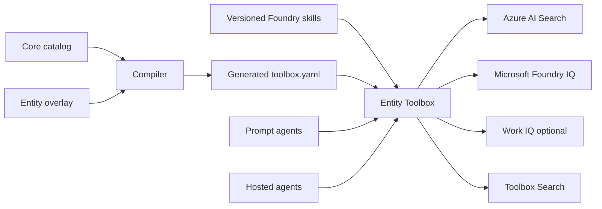

# Architecture

The add-on separates the centrally governed product from entity customization.

## Ownership Boundaries

The platform team owns `catalog/core.yaml`, common skills, validation rules, and release versions.
Each entity owns one overlay, Foundry project connections, Search indexes, knowledge bases, and
entity-scoping filters. Generated files are build artifacts and are not edited directly.

Azure AI Search provides indexed enterprise retrieval; Microsoft Foundry IQ exposes knowledge-base
retrieval through an MCP project connection. Toolbox Search is a distinct tool for discovering the
available tools, not a document-retrieval provider. Work IQ supplies delegated employee and M365
context: it is optional and disabled by default in the shared catalog, but enabled by the Microsoft
overlay. Enterprise-grounding directs Search and Foundry IQ source selection and citations;
the Microsoft-specific workplace-context skill guides authorized Work IQ retrieval and consent
failure handling without treating workplace conversations as policy authority.

The Toolbox consumer endpoint follows the promoted default version. Agents therefore keep a stable
endpoint while platform operators test a version-specific endpoint and promote or roll back versions.

## Security Boundaries

- Foundry project connections hold credentials; YAML contains references only.
- Read and write MCP services should use separate identities and connections.
- Write tools must declare `require_approval: always`, and the agent runtime must enforce it.
- Work IQ uses delegated user context and is currently unsupported with network-isolated projects.
- Skills are preview resources and must exist in the same Foundry project as their Toolbox.