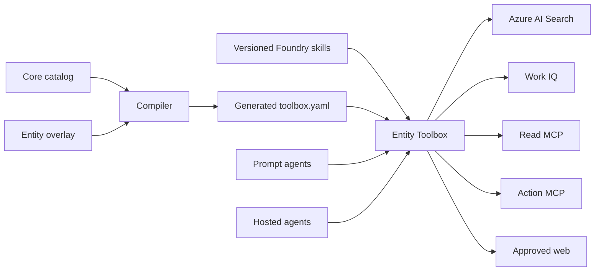

# Architecture

The add-on separates the centrally governed product from entity customization.

## Ownership Boundaries

The platform team owns `catalog/core.yaml`, common skills, validation rules, and release versions.
Each entity owns one overlay, Foundry project connections, approved domains, Search indexes, and
connector implementations. Generated files are build artifacts and are not edited directly.

The Toolbox consumer endpoint follows the promoted default version. Agents therefore keep a stable
endpoint while platform operators test a version-specific endpoint and promote or roll back versions.

## Security Boundaries

- Foundry project connections hold credentials; YAML contains references only.
- Read and write MCP services should use separate identities and connections.
- Write tools must declare `require_approval: always`, and the agent runtime must enforce it.
- Work IQ uses delegated user context and is currently unsupported with network-isolated projects.
- Skills are preview resources and must exist in the same Foundry project as their Toolbox.